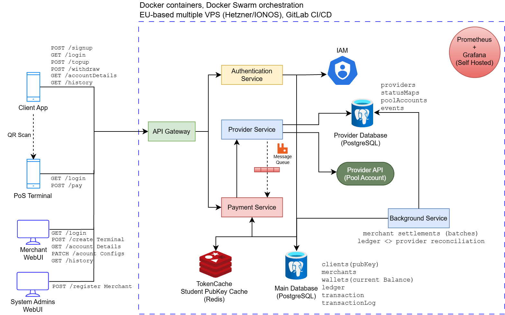
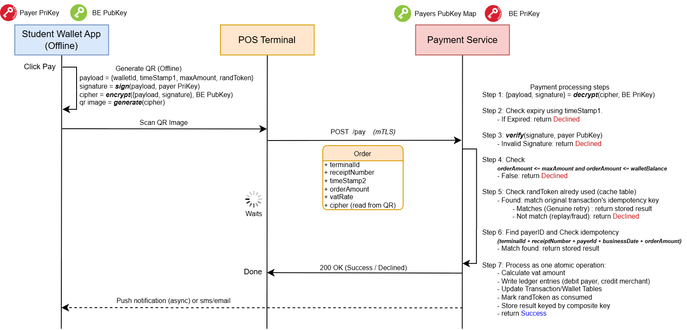

# Wallet and POS Platform

A backend API for a Hybrid wallet and point-of-sale payment processing system.

Clients keep money in wallets and pay merchants by showing a one-time signed QR code. Merchant terminals scan the code and forward it with order details to the backend. 
The platform moves the money between wallets on a double-entry ledger. No standard card network is involved. The platform also can be used for any closed network, for example campuses, transport ticketing, or event venues.

## Status

The system is in the early design phase. Only the Payment Service exists so far. It currently has both related and unrelated endpoints, such as merchant registration and client sign-up. 
These endpoints will move to separate services later, and more services will be added in this same repository.
The main goal is to create a GitHub organization with the mobile app and the web UI in separate repositories. The first code is being built spec by spec. 

[//]: # (See the [roadmap]&#40;#roadmap&#41;.)

## Main entities (Actors)

### Client

A client is a person who uses the mobile wallet app.

- The client has one main wallet created automatically on sign-up and can create more sub wallets later.
- At sign-up, the app creates a key pair. The private key stays in the phone's secure hardware and never leaves the device. Only the public key sends to the backend.
- The app regenerates this key pair periodically, for example weekly. System admins can make pubkey expired. In that case app re-generate again.
- The app then create a one-time signed and encrypted QR code per transaction when tap pay button fully offline.
- The app needs a connection only for top-up, withdrawal, syncing balance, transaction history, and account details. Otherwise it shows the last known balance when offline.
- Peer to peer money sharing is also possible.

### Merchant

A merchant is a business that accepts payments.

- A merchant is registered before use. It has one wallet and a payout IBAN.
- A merchant owns many terminals.
- A merchant starts refunds. A refund can be full or partial. It uses the original VAT rate, and the money goes back to the original wallet.
- A merchant files and pays its VAT to the government itself. The platform records the VAT but cannot verify it.
- The platform pays the merchant out through settlement.

### Terminal

A terminal is the device at a merchant that reads the client's QR code and calls the backend.

- The hardware can vary: a dedicated device, a smartphone, or a basic scanner, with or without a screen. It needs a camera or barcode scanner, and it must be online.
- Each terminal has its own certificate. It authenticates with mTLS before any request reaches the Payment Service.
- A terminal belongs to one merchant. It has no wallet. A payment credits the merchant's wallet, and the transaction records which terminal took it.

### Provider

A provider is a regulated bank or e-money company that maintains the pool account for the platform. It is not the client's bank.

- The platform often uses only one provider. It can also use several providers at the same time.
- The pool account holds all clients' money together. The ledger tracks who owns which part.
- The provider takes part only in top-up, withdrawal, and merchant settlement. At top-up, the client approves the payment at their own bank, and the money arrives in the pool account.
- A POS payment is only an entry in the platform's ledger. It never reaches the provider.
- Each provider's pool account is mirrored by one clearing wallet in the ledger.

## Architecture

Architecture Diagram is still in early design stage.

| Component | Role |
|---|---|
| API Gateway | Single entry point. Routes requests by path to the right service. |
| Authentication Service | Login, sessions, and two-factor authentication. |
| Payment Service | Payments, ledger, wallet balances, and transaction history. Hands top-up and withdrawal to the Provider Service. |
| Provider Service | Boundary to the providers. Handles top-up, payout, and webhooks. Maps provider states to internal states. |
| Main Database | Users, wallets, transactions, and the ledger. PostgreSQL. |
| Provider Database | Provider configuration, pool accounts, and the status mapping. PostgreSQL. |
| Redis | Short-lived store of used QR nonces. |
| RabbitMQ | Carries provider events to the Payment Service. |
| Background jobs | Settlement and daily reconciliation. |

The provider integration is a separate service. A provider code change does not need a redeploy of the payment code. A crash in the provider code does not take down `/pos/payments`. Slow provider calls cannot use up the threads or database connections that payments need.

Details are in [docs/architecture.md](docs/architecture.md).

## POS payment processing

The client's app signs a payload with the private key: wallet id, timestamp, maximum amount, and a random token. It encrypts the result with the backend's public key and shows it as a QR code. The terminal sends the code with the order details to `POST /pos/payments`.

The backend runs these steps:

1. Decrypt the payload.
2. Check the expiry with the timestamp.
3. Verify the signature with the client's public key.
4. Check that the order amount is within the client's maximum and within the wallet balance.
5. Check that the random token is unused.
6. Check idempotency with the composite key.
7. Write everything in one atomic database transaction, then respond.

**What the platform guarantees**

- A wallet never spends more than it holds.
- A QR code expires after a short time and works only once.
- The write in step 7 is atomic. It holds the ledger entries, the balance update, the transaction row, and the used token. Nothing happens partially. The response goes out after the commit.
- Declined attempts are stored in the transaction table. The ledger holds only successful money movements.

**Duplicates** are stopped by two keys. The random token catches the same QR code used twice. The composite key (terminal, receipt number, paying wallet, business date, amount) catches the same sale sent again under a new QR code, for example after a lost response.

**What the platform cannot guarantee**

- It cannot check that the terminal sent the correct order amount and VAT code. That is the merchant's responsibility.
- It cannot fully stop a compromised terminal from reusing a captured token. A short expiry and the maximum amount limit the damage.
- It cannot guarantee full idempotency, because the terminal sends no key of its own. A retry with a new receipt number looks like a new sale.

## Provider boundary and reconciliation

- The Provider Service has its own database. It has no foreign keys to the main database.
- Each provider has its own API and status words. The Provider Service maps them to `PENDING`, `SUCCESS`, and `FAILED`. A new provider is a new adapter plus configuration rows.
- Webhooks arrive at the Provider Service. It checks the event id, ignores duplicates, stores new events, and puts them on the queue.
- The Payment Service applies only valid status changes. An old `PENDING` event never overwrites `SUCCESS`.
- A daily reconciliation job compares the provider reports with the transactions and the ledger. A payment missing in the platform is treated as a missed webhook and processed normally. Other mismatches are flagged for the back office. The job never edits the ledger.

## Ledger

The ledger is append-only double-entry bookkeeping. Amounts include VAT. Each row stores the VAT part and the rate. A wallet balance is the sum of its ledger rows. The balance column on the wallet is a cache.

Example: a client pays €11.90 at 19% VAT. Three days later the merchant refunds €5.00.

| Date | Transaction | Wallet | Amount | VAT | Type |
|---|---|---|---|---|---|
| 2026-09-17 | T2345 | Client | -11.90 | -1.90 | payment |
| 2026-09-17 | T2345 | Merchant | 11.90 | 1.90 | payment |
| 2026-09-20 | T2363 | Client | 5.00 | 0.80 | refund |
| 2026-09-20 | T2363 | Merchant | -5.00 | -0.80 | refund |

The client spent 6.90, of which 1.10 is VAT. The merchant received 6.90, of which 1.10 is VAT.

## Deployment

- All components run on EU-based infrastructure, preferably in Germany. A second EU location serves disaster recovery.
- Services run as Docker containers on Docker Swarm. PostgreSQL runs with replication.
- Encrypted daily backups go to a separate EU location. Restores are tested.
- Terminals use mTLS. Secrets live in a secrets manager. Logs never contain QR tokens, private keys, or full IBANs.
- Prometheus and Grafana run on the platform's own servers.

## Tech stack

| Area | Choice | Reason                                                                                                |
|---|---|-------------------------------------------------------------------------------------------------------|
| Language | Java, Spring Boot | Common in fintech. `BigDecimal` gives exact decimal arithmetic. `@Transactional` gives atomic writes. |
| Database | PostgreSQL 18, Flyway | Strict ACID guarantees. Open source. Flyway for easy migration                                        |
| Ledger | Custom tables in PostgreSQL | Append-only. A dedicated ledger engine is a later option.                                             |
| Cache | Redis | Fast lookup of used nonces.                                                                           |
| Messaging | RabbitMQ | Lightweight. Integrates well with Spring.                                                             |
| Deployment | Docker, Docker Swarm, EU-based VPS | Simpler than Kubernetes. Keeps data in the EU.                                                        |
| CI/CD | GitLab |                                                                                                       |
| Observability | Prometheus, Grafana | Self-hosted. Metrics stay inside the company.                                                         |

## Documentation

| File | Content |
|---|---|
| [AGENTS.md](AGENTS.md) | Rules for AI coding agents and contributors |
| [docs/constitution.md](docs/constitution.md) | Mission, principles, roadmap, out of scope |
| [docs/architecture.md](docs/architecture.md) | Services, databases, deployment |
| [docs/domain/](docs/domain/) | Ledger, wallets, POS payment, provider boundary |
| [docs/api.md](docs/api.md) | Endpoint catalog |
| [docs/data-model.md](docs/data-model.md) | Tables and constraints |
| [docs/decisions/](docs/decisions/) | Technical decisions |
| [specs/](specs/) | One spec per feature |

## Development approach

This project uses spec-driven development. Each change starts as a markdown spec in `specs/`. The spec lists requirements, edge cases, and acceptance criteria. The code is written to match it. [AGENTS.md](AGENTS.md) describes the full workflow.

[//]: # (## Roadmap)

[//]: # ()
[//]: # (- [ ] Project skeleton with Flyway migrations)

[//]: # (- [ ] Ledger mechanics and the VAT example, with tests)

[//]: # (- [ ] `POST /pos/payments` with a concurrency test)

[//]: # (- [ ] QR token layer: signature, encryption, nonce)

[//]: # (- [ ] Top-up and withdrawal against a mock provider)

[//]: # (- [ ] Settlement and reconciliation)

[//]: # ()
[//]: # (## Getting started)

[//]: # ()
[//]: # (The skeleton is not in place yet. The setup steps will be added with the first spec.)